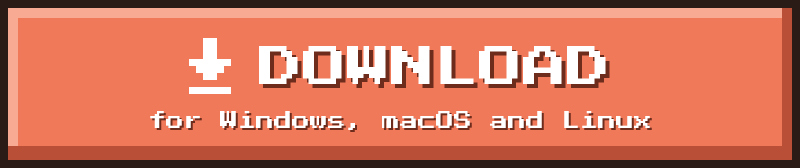
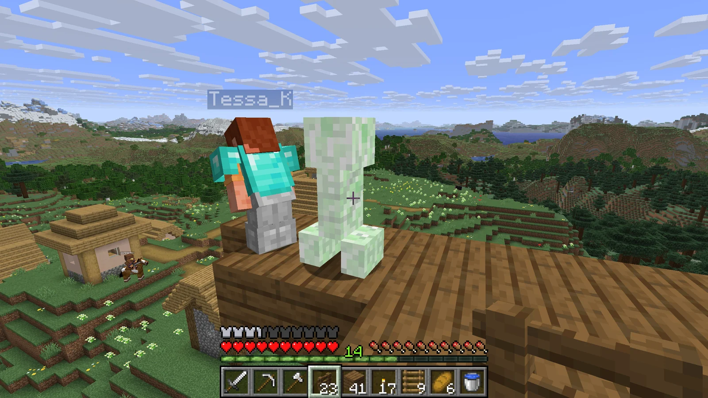
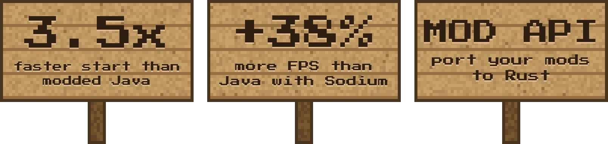
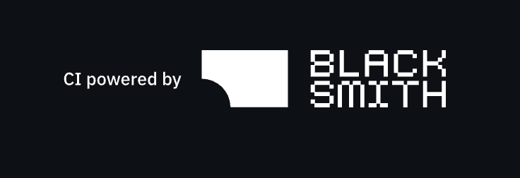

# Magnetite

**Minecraft: Java Edition 26.3 in Rust on PC, Android and iOS, from one core.**

Magnetite is a fork of [Horizon](https://github.com/horizon-rust/horizon) that brings the desktop game, an Android
port and an iOS port together on a single shared Rust core, so a fix or a mod hook lands on every platform at once.

- **Magnetite**: Windows, macOS, Linux.
- **Magnetite Android** and **Magnetite iOS**: the same core with the `mobile` build profile, touch controls you can
  lay out yourself, and Microsoft and Ely.by sign-in inside the game.
- **Mods** in WebAssembly, Lua or native Rust, with the same hooks on every platform, and Magnetite's own
  [mod platform](https://github.com/izrikmizrik/magnetite-mods).

Work in progress: the merge plan and status are in [docs/unification/](docs/unification/plan.md). Licence: GNU LGPL
3.0 or later, as Horizon (see below).

## Download

Preview builds are on the [Releases](https://github.com/izrikmizrik/Magnetite/releases) page:

| Platform | File | How to install |
| --- | --- | --- |
| Android 9+ (arm64) | `Magnetite-<version>-android-arm64.apk` | Allow installs from unknown sources and open the file. Later builds install over it. |
| iOS 16+ | `Magnetite-<version>-ios-unsigned.ipa` | SideStore, AltStore or TrollStore. The launcher shows when the signature expires. |
| PC | coming in the next releases | |

Sign in with Microsoft (a code you type on any device), Ely.by, or play offline. On the first start the game
downloads its own files (about 530 MB); nothing else needs installing. Early versions may crash: the launcher's
"Share the log" sends the game's log.

## The launcher

The screen before the game, the same on every platform: upright on a phone, with a sidebar on a PC.

- **Accounts:** several kept at once; the account's plate picks one, the people button signs in another.
- **Profiles:** each with its own settings and touch layout, sharing the worlds, accounts and game files.
- **Mods:** the installed ones with a switch each, and the mod platform to find and install more.
- **Settings:** graphics API (Vulkan or OpenGL ES on Android), render resolution, frame rate limit, camera
  sensitivity, language; on iOS, the time left until the app must be signed again.
- **Open the game folder** in the system's file manager, and **share the log**.

## Modding

Magnetite's modding is Horizon's with differences: its own mod platform, Lua, prebuilt native mods for phones,
and hooks added for porting mods such as Farmer's Delight and Create (load-time data transforms, crafting kinds
with remainders, the block entity tick's level, the used stack, `/reload` for mod tables, `copy_components`, mod
trades).

- [The modding guide](docs/magnetite/modding.en.md) ([по-русски](docs/magnetite/modding.md)): the kinds of mod and
  where each runs, hooks, Parts, the Host, Lua, determinism, the phones' limits, publishing.
- [The function reference](docs/magnetite/modding-reference.en.md)
  ([по-русски](docs/magnetite/modding-reference.md)): all 761 hooks and 364 `Host` methods, one line each.

| Kind | PC | Android | iOS |
| --- | --- | --- | --- |
| Content (`assets/`, `data/`) | yes | yes | yes |
| WebAssembly | yes | yes | yes (interpreted without JIT) |
| Lua (LuaJIT) | yes | yes | yes (interpreted) |
| Native Rust | built by the launcher | prebuilt by the mod farm (planned) | with JIT (planned) |

## Building

The workspace builds as Horizon's does ([build guide](docs/native-client.md#run-from-a-checkout)); the phones'
packaging is in `packaging/android` and `packaging/ios`, and the `android-apk` and `ios-ipa` workflows build the
APK and IPA (for a `v*` tag, onto its release). On Windows, LuaJIT builds with `msvcbuild.bat`, so run Cargo from a
Visual Studio developer prompt.

NOT AN OFFICIAL MINECRAFT PRODUCT. NOT APPROVED BY OR ASSOCIATED WITH MOJANG OR MICROSOFT.

## Thanks

Magnetite stands on other people's work:

- **[Horizon](https://github.com/horizon-rust/horizon)**, founded by [Ludovic Marie](https://lu4ovic.com) and built by
  the Horizon Team and [its contributors](https://github.com/horizon-rust/horizon/graphs/contributors): the whole engine,
  rewritten from scratch in Rust. Magnetite's core is Horizon's.
- **[Horizon iOS](https://github.com/razlua/horizon-ios)** by razlua (Ferrite): the iOS port that showed the way, with
  sign-in inside the game, the touch controls and their editor, and keyboard, mouse and controller support on iPhone
  and iPad.
- **[Horizon Android](https://github.com/GoyDevv/Horizon-Android)** by GoyDevv and its contributors: the Android port,
  its launcher, touch layouts, gyro aiming and device integration.
- **[e4mc](https://e4mc.com/)** by [Skye](https://github.com/vgskye) ([the mod](https://github.com/vgskye/e4mc-minecraft-architectury)):
  open a world to friends from any connection with no port forwarding. Magnetite's e4mc builds use a native Rust port,
  [e4mc-for-rust](https://github.com/izrikmizrik/e4mc-for-rust), with e4mc's relays.
- **[Starling](https://github.com/starling-client/starling)** by Vasysik and its contributors: the touch layout Horizon
  adapted.

Code from the iOS and Android forks and from e4mc-for-rust keeps its MIT licence notices.

---

*The Horizon README follows.*

  <picture>
    <source media="(prefers-color-scheme: dark)" srcset="docs/media/readme/title-dark.png">
    
  </picture>

  <b>Minecraft: Java Edition 26.3, rewritten from scratch in Rust.</b> 
  It opens your worlds, generates the same terrain and plays by the same rules, without Java.

   
  You need your own copy of Minecraft: Java Edition.

  <a href="https://playhorizon.dev/docs/install"><b>Install guide</b></a> ·
  <a href="https://playhorizon.dev/docs/"><b>Docs</b></a> ·
  <a href="https://playhorizon.dev/mods"><b>Mods</b></a> ·
  <a href="https://discord.gg/playhorizon"><b>Discord</b></a>

  

  

  Against Java Edition with Sodium, Lithium, FerriteCore and ImmediatelyFast on a Ryzen 7 9800X3D with an RTX 5080. More computers on the <a href="https://playhorizon.dev/benchmarks">benchmarks page</a>.

<h2 align="center">What you get</h2>

- **Vanilla Minecraft:** survival, creative and hardcore in every dimension, with the same terrain, mobs, villagers and redstone. Your saves open as they are.
- **Multiplayer:** vanilla and Horizon servers, LAN, and invite codes for playing your world with friends. You can [host a server](https://playhorizon.dev/docs/hosting) too.
- **Mods:** Horizon's own mod system, with mods like zoom and a minimap, and shader packs. Browse the [catalogue](https://playhorizon.dev/mods) or [make a mod](https://playhorizon.dev/docs/make-a-mod).
- **Beyond vanilla:** terrain up to 1,024 chunks away, HDR, controller support, graphics presets and dynamic lights.

The dedicated server is measured too: in a four-thread server run, Horizon averaged 47.83 ms per tick with 50 bots while vanilla's watchdog stopped its server during warm-up. Horizon used 1.11 GB of RSS at 50 bots, and the full comparison against vanilla, Paper and Fabric + Lithium is in [the server benchmark](docs/performance/server-vs-vanilla.md). Paper is a separately optimized, feature-breaking server and is a reference point rather than a direct vanilla-compatible comparison.

<h2 align="center">What you need</h2>

- **Your own copy of Minecraft: Java Edition.** Horizon ships no Minecraft files. It builds them from the game you bought, so install version 26.3 and start it once.
- **Windows, macOS or Linux:** Windows on x64 or ARM64, macOS 12 or later, Linux on x86-64.

<h2 align="center">Made by the Horizon Team</h2>

<table align="center">
  <tr>
    <td align="center" width="140"><a href="https://github.com/kacpherek"> <b>Kacper</b></a></td>
    <td align="center" width="140"><a href="https://github.com/Online5277"> <b>Cosmic</b></a></td>
    <td align="center" width="140"><a href="https://github.com/levzzz5154"> <b>levzzz</b></a></td>
    <td align="center" width="140"><a href="https://github.com/rdbtCVS"> <b>rdbt</b></a></td>
    <td align="center" width="140"><a href="https://github.com/dezer-x"> <b>Anthony S</b></a></td>
    <td align="center" width="140"><a href="https://github.com/NikitaMGrimm"> <b>Nikita</b></a></td>
    <td align="center" width="140"><a href="https://github.com/ludovic111"> <b>Ludovic Marie</b></a> Founder</td>
  </tr>
</table>

  and everyone who has contributed  
  

  

  <a href="docs/native-client.md#run-from-a-checkout"><b>Build guide</b></a> ·
  <a href="CONTRIBUTING.md"><b>Contributing</b></a> ·
  <a href="GOVERNANCE.md"><b>Governance</b></a> ·
  <a href="https://github.com/sponsors/ludovic111"><b>Sponsor</b></a>

Horizon is released under the [GNU LGPL, version 3 or later](LICENSE), for the project's original work. Code merged before the move from MIT stays available under the [MIT licence](LICENSES/MIT.txt). Dependencies keep their own licences, see the [notices](THIRD_PARTY_NOTICES.md). Founded by [Ludovic Marie](https://lu4ovic.com) and built by the Horizon Team and [its contributors](https://github.com/horizon-rust/horizon/graphs/contributors). You can support it on [GitHub Sponsors](https://github.com/sponsors/ludovic111).

NOT AN OFFICIAL MINECRAFT PRODUCT. NOT APPROVED BY OR ASSOCIATED WITH MOJANG OR MICROSOFT. Minecraft is a trademark of Mojang Synergies AB; its code and assets belong to Mojang and Microsoft under the [Minecraft EULA](https://www.minecraft.net/en-us/eula).
